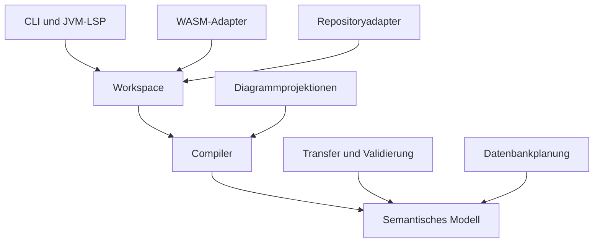

# Architektur und Modulgrenzen

## 1. Leitentscheidung

Das semantische Modell ist der gemeinsame fachliche Kern. Der Compiler baut es aus versionierten Quellen auf. Der Workspace organisiert Änderungen, Abhängigkeiten und Wiederverwendung. Hostadapter beschaffen Modelle, transportieren LSP-Nachrichten oder exportieren Browserfunktionen. Verbraucher erstellen kompakte Pläne für Diagramme, Transfer, Validierung oder Datenbankabbildung.

Diese Grenzen übernehmen die nützliche Trennung von Session, Quellen, Snapshots und Läufen aus [ilic-fork](https://github.com/edigonzales/ilic-fork/blob/main/docs/architecture/module-boundaries.md). Die interne Java-Struktur ist ein neuer Entwurf. Die untenstehenden Regeln sind Projektentscheidungen.

## 2. Module und Abhängigkeiten

Ein Pfeil in dieser Tabelle bedeutet: Das Modul links darf im Produktionscode die API rechts verwenden. Transitive Bibliotheksabhängigkeiten werden nicht automatisch zur erlaubten fachlichen Kopplung.

| Modul | Erlaubte Projektabhängigkeiten | Verantwortung | Entstehung |
|---|---|---|---|
| `interlis-model` | keine | Quellenwerte, Diagnostik-/Ausführungsverträge, semantische Werte/Graphen, CompiledSchema-Vertrag | P0/P1 |
| `interlis-compiler` | model | ANTLR-Adapter, eigene Syntax, Bindung, Typprüfung, AnalysisSnapshot, CompilerEngine | P0/P1 |
| `interlis-workspace` | compiler, model | Quellenrevisionen, Resolver-SPI, importierte Closure, Cache/Invalidierung, Sitzungen | P1 |
| `interlis-repository` | workspace, compiler, model | JVM-Datei-/HTTP-Beschaffung, Repositoryindex, Inhaltsspeicher | P1 lokale Basis; P2 vollständig |
| `interlis-projection` | compiler, model | Editor-/Diagramm-DTOs und lesende Exporte; kein Workspacebesitz | P1 |
| `interlis-cli` | compiler, workspace, repository, projection, model | CLI-Vertrag, Streams, Legacydarstellung, Prozessstatus | P1/P3 |
| `interlis-lsp` | workspace, repository, compiler, projection, model | LSP4J-/JVM-Adapter und laufende Editorintegration | P1/P3 |
| `interlis-wasm-bridge` | workspace, compiler, projection, model | Gemeinsames Sessionprotokoll/JSON, sobald tatsächlich von beiden Adaptern genutzt | P1 bei Bedarf |
| `interlis-wasm-teavm` | wasm-bridge sofern vorhanden; workspace, compiler, projection, model | TeaVM-Exports, Runtime-/Workeranbindung | P0/P1 |
| `interlis-wasm-webimage` | wasm-bridge sofern vorhanden; workspace, compiler, projection, model | Web-Image-Exports und Vergleichsversuch | P1 |
| `interlis-transfer` | model | TransferPlan und Streaming-I/O, später optionaler IOM-Adapter | P4 |
| `interlis-validation` | transfer, model | ValidationPlan und Validatorlaufzeit | P4 |
| `interlis-db` | transfer, model; validation nur bei expliziter Verwendung | SchemaPlan, Metadatenkompatibilität, DB-Betrieb | P5 |
| `interlis-compat-ili2c` | compiler, model; gezielt alte Bibliothek | Optional materialisierte Legacy-Java-API | nur bei eigenem Abnahmeauftrag |

Direkte Abhängigkeiten sind im jeweiligen `build.gradle` sichtbar. Ein Modul wird erst angelegt, wenn seine ersten Quellen und Tests entstehen. Die Tabelle ist kein Auftrag, bei P0 zwölf leere Projekte zu erzeugen. Zunächst reichen model, compiler, cli und der aktive WASM-Adapter; workspace und projection folgen unmittelbar mit dem vertikalen P1-Abschnitt.

`interlis-model` enthält eine kleine technische Grundlage unter `guru.interlis.source`, `guru.interlis.diagnostics` und `guru.interlis.execution`. Das vermeidet ein zusätzliches Mini-Modul mit nur wenigen Records. Es enthält keine Parser-, Workspace-, Repository- oder Loggerimplementierung. Sollte die Grundlage später unabhängige Verbraucher erhalten, ist eine Aufteilung möglich, ohne die öffentlichen Java-Pakete umzubenennen.

Der Repositorypfeil beschreibt eine Codeabhängigkeit zum dort definierten SPI. Zur Laufzeit ruft ein Host den Adapter auf und übergibt dessen Ergebnis dem Workspace. Ein Pfeil zum Workspace bedeutet deshalb keine autonome Netzwerkanforderung während einer Typprüfung.

## 3. Öffentliche Datenebenen

### 3.1 SourceText und SyntaxSnapshot

`SourceText` ist unveränderlich und enthält eine opake Quellenidentität, eine Revision und den exakten Text. Ein `SyntaxSnapshot` enthält zusätzlich eigene Tokens, Syntaxknoten, Quellbereiche und Syntaxdiagnostik. Der ursprüngliche Text plus Tokens und Lücken muss Kommentare/Whitespace ohne Bedeutungsverlust darstellen. ANTLR-Objekte bleiben intern und können nach dem Lowering freigegeben werden.

### 3.2 AnalysisSnapshot

Der Snapshot bezeichnet einen einzigen Eingabestand. Er trägt Quellenrevisionen, Syntaxsichten, semantischen Graph, Diagnosemenge, Analyseabdeckung und Abfrageindizes. Er darf partiell sein. Eine erfolgreiche Navigation zu einer Deklaration besagt nicht, dass deren Typ bereits gültig aufgelöst ist. Diese Zustände sind typisiert.

### 3.3 CompiledSchema

`guru.interlis.model.CompiledSchema` ist ein öffentliches nur lesendes Interface. Die eigene Implementierung `guru.interlis.compiler.internal.DefaultCompiledSchema` ist final und unveränderlich. Ausschliesslich `CompilationGate` erzeugt diese Implementierung nach vollständiger Prüfung der angeforderten Closure. Damit bleibt model unabhängig von compiler.

Die Garantie gilt für Ergebnisse der Engine. Ein öffentliches Java-Interface ist keine Sicherheitsgrenze gegen beliebige fremde Implementierungen. Es wird kein kompliziertes Zertifikats-, Reflection- oder Split-Package-Verfahren benötigt. Ein Architekturtest prüft im eigenen Repository, dass keine alternative Produktionsimplementierung das Gate umgeht.

Die gültige Sicht kann semantische Daten mit dem AnalysisSnapshot teilen. Keine doppelte vollständige Objektkopie ist vorgeschrieben. Geteilte Daten müssen unveränderlich sein, und ihre Lebensdauer muss das Ergebnisobjekt selbst sichern. `Workspace.close()` darf bereits ausgelieferte Snapshots nicht unlesbar machen.

## 4. Identitäten und Eigentum

| Wert | Gültigkeitsbereich | Verwendung |
|---|---|---|
| `SourceId` | vom Host kanonisierte logische Quelle | Dokumentbezug unabhängig vom Inhalt |
| `SourceRevision` | monoton je SourceId in einem Workspace | Erkennung veralteter Änderungen/Positionen |
| `WorkspaceRevision` | monoton je Workspace | atomarer Eingabestand und Veröffentlichung |
| `SnapshotId` | ein veröffentlichter Analysestand | Schutz vor gemischten Abfragen |
| `SymbolId` | opak, sitzungsbezogen stabil bei eindeutiger Wiedererkennung | Graphbeziehungen und UI-Identität |
| `TypeId`, `ExpressionId`, `ScopeId` | im jeweiligen Snapshot aufgelöst | interne fachliche Beziehungen |
| `SymbolRef` und ähnliche Ref-Werte | SnapshotId plus Element-ID | öffentliche referenzbezogene API |

Ein qualifizierter Name ist ein fachlicher Name, keine Garantie dauerhafter Identität. Umbenennen, Duplikate und Verschieben verlangen bewusst definierte Identitätsentscheidungen. Neue Typen oder Quellpositionen werden niemals stillschweigend aus einem alten Snapshot verwendet. Nach einem Neuaufbau können UI-Adapter anhand dokumentierter Zuordnungen navigierbare Elemente wiedererkennen; sie dürfen dabei keine semantische Gültigkeit aus der früheren Analyse übernehmen.

Graphinterne Listen besitzen eine explizite Ordnung. Maps sind Indizes; ihre zufällige Iterationsreihenfolge darf keine Transfer- oder Diagnoseordnung bestimmen. Öffentliche Sammlungen sind unveränderliche Kopien oder garantiert unveränderliche Sichten auf unveränderlichen Speicher.

## 5. Ablauf einer Kompilierung

1. Der Host liest Konfiguration, stellt Quelltexte bereit und beschafft fehlende Modelle über das Repository-SPI.
2. Der Workspace erfasst eine unveränderliche Closure mit Resolverprovenienz und Revisionen.
3. `CompilerEngine` verarbeitet ein `CompilationRequest` mit einem vollständigen `SourceSet`; die Engine beschafft keine Daten nach.
4. Der Syntaxadapter parst neue/geänderte Texte und erzeugt eigene Syntaxrepräsentationen.
5. Phasen sammeln Deklarationen, binden Namen, prüfen Typen und fachliche Regeln.
6. Die Engine veröffentlicht `AnalysisSnapshot` und ein typisiertes Kompilierungsergebnis.
7. Das Gate gibt bei erfüllten Bedingungen eine `CompiledSchema`-Sicht frei.
8. Der Host prüft vor einer Editorveröffentlichung, ob die angeforderte Revision noch aktuell ist.
9. Eine Projektion erzeugt ein Verbraucherformat; Layout, JDBC und Datensatzvalidierung finden in ihren eigenen Schichten statt.

Abbruch ist ein expliziter Pfad durch diesen Ablauf. Ein interner Fehler ist weder ein Syntaxfehler noch eine gültige leere Modellmenge. Abschlussereignisse und Resultatstatus müssen denselben Lauf beschreiben.

## 6. Dienste und Konstruktion

Öffentliche Einstiegspunkte werden durch kleine Fabriken oder Konstruktoren mit expliziten Abhängigkeiten erzeugt. Beispielhafte Rollen:

| Rolle | Erzeugung | Zustand |
|---|---|---|
| `CompilerEngine` | `CompilerEngines.create()` bzw. `CompilerEngines.create(CompilerServices)` | keine Workspaceglobaldaten; laufbezogener Zustand intern |
| `Workspace` | Factory mit Engine, Resolverzustand und Optionen | besitzt Quellen, Revisionen und begrenzte Caches |
| `ModelResolutionService` | Konstruktor mit provider/readers/policy | keine globale Netzwerkkonfiguration |
| `DiagramProjector` | zustandslos oder immutable Options | reine Projektion eines Snapshots |
| `LegacyDiagnosticRenderer` | immutable profilierter Katalog | Darstellung, keine fachliche Fehlerentscheidung |
| `TransferPlanner` / `ValidationPlanner` / `SchemaPlanner` | explizite Profil-/Capabilities-Eingaben | reine Plangenerierung; IO-Ausführung getrennt |

Die exakten öffentlichen Signaturen stehen in den Fachkapiteln und im [API-Register](16-api-register-und-vertragstests.md). Diese Rollentabelle führt keine zusätzliche Factorysignatur ein. Eine testbare API rechtfertigt eine Schnittstelle; nicht jede Klasse erhält automatisch ein `I…`-Interface plus Implementierung plus Factory.

## 7. Fachliche Projektionen und Overlays

Der Compiler beschreibt die Sprache unabhängig davon, welche Verbraucher bereits implementiert sind. Ein Exporter kann ein gültiges Modell aufgrund seiner eigenen Capability-Matrix ablehnen. Er muss die nicht unterstützten Konstrukte nennen und darf keine Elemente kommentarlos verlieren.

`SemanticOverlays` beschreibt fachliche Zusatzinformationen wie externe Übersetzungs-/CRS-/Metaattributkonfiguration mit Herkunft und Präzedenz. Ein Overlay wird vor der betroffenen Analyse bzw. Planung als Eingabe berücksichtigt und in Fingerprints eingeschlossen. Es darf nicht nachträglich gemeinsame Modellobjekte verändern. Zeitlich veränderliche SRS- oder Geometriecaches gehören in einen Laufzeitkontext des Verbrauchers.

Planfingerprints unterscheiden mindestens Modellsemantik, Sprachfassung, Transferprofil, Mappingprofil, Overlay und Planversion. Ein alleiniger Hash der Modellnamen ist ungeeignet. Zwei Pläne mit gleichen sichtbaren Klassennamen können aufgrund von Constraints, Kardinalitäten, Übersetzungen oder effektiver Reihenfolge fachlich verschieden sein.

## 8. Architekturregeln und Abnahmen

| ID | Normative Anforderung | Phase | Abnahme |
|---|---|---|---|
| ARCH-001 | Der Modulgraph MUSS azyklisch sein und die erlaubten Abhängigkeiten einhalten. | P0 | Build-/Architekturtest liest Produktionsgraph und Importgrenzen. |
| ARCH-002 | Öffentliche API DARF keine ANTLR-, LSP-, JDBC- oder UI-Typen in den portablen Kern tragen. | P1 | Signaturprüfung plus portable Kompilierung. |
| ARCH-003 | Alle veröffentlichten fachlichen Snapshots MÜSSEN unveränderlich sein. | P1 | Mutations-/Lebensdauertests einschliesslich nach Workspace.close. |
| ARCH-004 | CompiledSchema unserer Engine MUSS ausschliesslich über CompilationGate entstehen. | P1 | Architektur- und Fehlerpfadtests. |
| ARCH-005 | Compiler und Projektionen DÜRFEN keine globale Prozesskonfiguration verändern. | P1 | Zwei isolierte Sitzungen mit abweichenden Profilen beeinflussen sich nicht. |
| ARCH-006 | Fachliche Reihenfolgen MÜSSEN explizit modelliert werden. | P1/P2 | Geerbte/überschriebene Attribute und Rollen bleiben JVM/WASM gleich. |
| ARCH-007 | Resolverzustand und Overlays MÜSSEN in den Eingabestand und Cachevertrag eingehen. | P1 | Änderung ohne Quelltextänderung erzwingt erforderliche Neuanalyse. |
| ARCH-008 | Diagramm-/Transfer-/Validator-/DB-Consumer MÜSSEN ihre Unterstützung explizit ausweisen. | P1/P4/P5 | UnsupportedFeature erzeugt Ergebnis mit betroffenen Elementen. |
| ARCH-009 | Das Projekt DARF keine DI-/Server-/ORM-Laufzeit für reine Modellanalyse verlangen. | P0 | Minimale Java-main-/WASM-Anwendung analysiert aus Strings. |
| ARCH-010 | Wiederverwendung MUSS ein optionaler Optimierungsparameter bleiben. | P1 | Reuse.none und Cachepfad liefern fachlich gleiche Resultate. |

## 9. Bewusst spätere Entscheidungen

JPMS-Deskriptoren, persistente Compiler-Caches, inkrementelle Teilbaumparser und ein eigenes Plugin-Ladesystem sind kein P0/P1-Auftrag. Packagegrenzen, Serialisierungsverträge und Capability-Modelle dürfen sie ermöglichen. Eine Einführung benötigt einen gemessenen Bedarf oder einen konkreten Verbraucher und aktualisierte Abnahmen.

Es gibt zunächst keinen zentralen REST-Microservice als Voraussetzung. Derselbe Compiler kann später in einen Server eingebettet werden. Prozessgrenzen lösen fachliche Kopplungen nicht automatisch; zuerst müssen die Bibliotheksverträge tragfähig sein.
