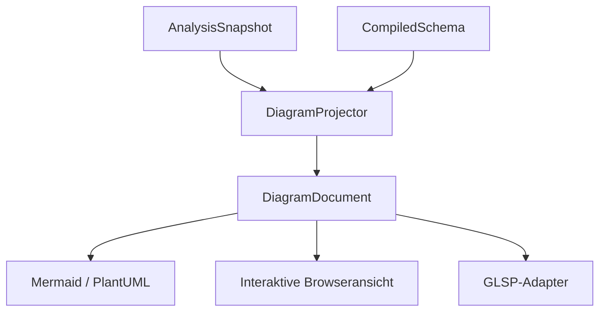

# 11 – Modellvisualisierung und versionierte Projektionen

## 1. Ziel und Zuständigkeit

Die Visualisierung ist ein Verbraucher des gemeinsamen Metamodells. Sie muss sowohl ein erfolgreiches `CompiledSchema` als auch sinnvolle Teile eines `AnalysisSnapshot` darstellen können. Ihre Interpretation von Vererbung, Typen, Rollen und Referenzen kommt aus dem Compiler; Renderer implementieren diese Regeln nicht erneut.

Der verbindliche Datenweg lautet:



`interlis-projection` darf `interlis-model` und für partielle Analyse `interlis-compiler` verwenden. Es hängt nicht von Workspace, LSP4J, Browser-DOM, Sprotty, Cytoscape, GLSP, ELK, JTS, JDBC oder Dateisystemzugriff ab. Layout und Veröffentlichung sind Adapteraufgaben.

Eine Diagrammprojektion ist kein vollständiges Austauschformat des Metamodells. Nicht angezeigte Detailtypen, Ausdrücke und Metadaten bleiben im Compiler verfügbar. Für andere Verbraucher entstehen eigene `TransferPlan`-, `ValidationPlan`- und `SchemaPlan`-Verträge gemäss [12](12-transfer-validierung-und-datenbanken.md). Ein Diagramm-DTO darf nicht versehentlich deren fachliche Grundlage werden.

### 1.1 Anforderungen

| ID | Normative Anforderung | Phase | Abnahme |
|---|---|---|---|
| VIZ-001 | Eine einzige rendererunabhängige Projektion MUSS die fachliche Diagrammstruktur erzeugen. | P1 | Zwei Renderer zeigen dieselben Knoten, Rollen und Beziehungen. |
| VIZ-002 | Modell-, Topic-, Klassen-, Domänen- und Vererbungsdarstellung MUSS bereits die P1-Strecke begleiten. | P1 | Durchgängiges Editor-/Wasm-Fixture mit Navigation. |
| VIZ-003 | Partielle Analysen MÜSSEN ihren Zustand und fehlende Bezüge erkennbar machen. | P1 | Fehlender Import erzeugt markierten Stub und keinen erfundenen Zieltyp. |
| VIZ-004 | Diagramme MÜSSEN SnapshotId und Quellrevisionen erhalten. | P1 | Alte Diagrammanker werden nach einer Quelländerung geprüft. |
| VIZ-005 | Knoten-/Kantenidentitäten MÜSSEN bei eindeutig unveränderter Semantik innerhalb einer Sitzung stabil bleiben. | P1 | Kommentaränderung und Einfügen einer fremden Assoziation ändern bestehende IDs nicht. |
| VIZ-006 | Fachliche Namen DÜRFEN nicht als einzige Identität dienen. | P1 | Gleichnamige Fehlerdeklarationen und Umbenennung. |
| VIZ-007 | Assoziationen mit Attributen oder mehr als zwei Rollen MÜSSEN vollständig als eigene Elemente darstellbar sein. | P2 | N-äre und attributierte Assoziationsfixtures. |
| VIZ-008 | Lokale, geerbte und überschriebene Elemente MÜSSEN unterscheidbar sein. | P2 | Effektive Reihenfolge stimmt mit Metamodellqueries überein. |
| VIZ-009 | Filter MÜSSEN alle Renderer aus denselben Optionen ableiten. | P1–P2 | Rendererübergreifende Projektionstests für dieselben Filter. |
| VIZ-010 | Layoutpositionen DÜRFEN den Compilergraphen nicht verändern. | P1 | Verschieben/Filtern verändert keine Semantik oder Quellrevision. |
| VIZ-011 | Fehlende Rendererfähigkeiten MÜSSEN explizit ausgewiesen werden. | P1–P3 | Keine stille Auslassung n-ärer Beziehungen oder falsche Gültigkeitsaussage. |
| VIZ-012 | Ausgabeformate MÜSSEN Bezeichner, Dokumentation und Labels korrekt escapen. | P1 | Sonderzeichen, Zeilenwechsel und rendererähnlicher Modelltext. |
| VIZ-013 | Statische Exporte MÜSSEN deterministisch sein. | P1 | Gleiche Projektion ergibt byteidentischen Mermaid-/PlantUML-Text. |
| VIZ-014 | Die interaktive Browseransicht SOLL vorhandene Sprotty-/elkjs-Arbeit wiederverwenden. | P1 | Kleiner geprüfter Adapter statt neuer fachlicher Rendererlogik. |
| VIZ-015 | GLSP-basierte grafische Modellbearbeitung DARF nicht Voraussetzung einer lesenden Visualisierung werden. | P1–P3 | P1 ohne GLSP-Server betreibbar; späterer Adapter separat. |
| VIZ-016 | Eine Diagrammbegrenzung MUSS ihren reduzierten Umfang ausdrücklich melden. | P1 | Kleines Knoten-/Kantenbudget erzeugt LIMITED, keine scheinbar vollständige Ausgabe. |
| VIZ-017 | Kanonische Namen und übersetzte Anzeigenamen MÜSSEN getrennt bleiben. | P2 | Sprache wechseln verändert Labels, nicht fachliche Identität. |
| VIZ-018 | Export und interaktive Navigation MÜSSEN aus demselben Quellstand entstehen. | P1 | Änderung während Layout/Export führt zu Stale-Prüfung. |

## 2. Eingabe, Optionen und Ergebnis

### 2.1 Öffentliche API

```java
public interface DiagramProjector {
    DiagramProjectionOutcome project(
        DiagramInput input,
        DiagramOptions options,
        CancellationToken token);
}

public sealed interface DiagramInput {
    record FromAnalysis(AnalysisSnapshot snapshot) implements DiagramInput {}
    record FromSchema(CompiledSchema schema) implements DiagramInput {}
}
```

Der öffentliche Einstieg lautet `DiagramProjectors.create() -> DiagramProjector`. Er erzeugt den zustandslosen Standardprojektor mit den in diesem Kapitel festgelegten typisierten Formatierern und ohne I/O. Implementierungshelfer bleiben intern; ein Aufrufer muss kein eigenes Dependency-Injection-System und keine Rendererbibliothek bereitstellen. Optionen werden je Aufruf übergeben und nicht global mutiert.

`DiagramProjectionOutcome` besitzt die Varianten `Produced(DiagramDocument document, List<ProjectionNotice> notices)` und `Rejected(List<ProjectionNotice> reasons)`. Abbruch verwendet den gemeinsamen `OperationCancelledException`-Vertrag. Eine fachlich partielle, aber darstellbare Eingabe führt zu `Produced` mit passendem Status. Eine unpassende Snapshotreferenz, unmögliche Auswahl oder nicht darstellbare zwingende Projektionsanforderung führt zu `Rejected`.

`ProjectionNotice` ist kein INTERLIS-Sprachfehler. Es enthält `ProjectionNoticeCode`, Schweregrad, Nachrichtenschlüssel/-argumente, optionalen SymbolRef und optionalen SourceRange. Beispiele für Codes sind `UNSUPPORTED_PRESENTATION`, `UNRESOLVED_TARGET`, `PROJECTION_LIMIT_REACHED` und `STALE_SELECTION`. Compilerdiagnostik bleibt im Eingangssnapshot erhalten; ein Projektionshinweis darf dessen Gültigkeit weder aufheben noch herstellen.

Wird ein solcher Zustand über den gemeinsamen Verbraucher-Diagnosekanal ausgegeben, verwendet der Adapter das Mapping auf `ILI-PROJ-0001` beziehungsweise die in Kapitel 09 vorgesehenen Projektionsdiagnosen und führt den feineren ProjectionNoticeCode als typisierten Grund mit. Das interne Hinweisobjekt und der gemeinsame Diagnosecode sind damit zwei dokumentierte Darstellungen desselben Verbraucherbefunds, keine konkurrierenden Sprachdiagnosen.

### 2.2 Optionen

`DiagramOptions` ist ein unveränderlicher Wert mit mindestens:

| Feld | Typ/Werte | Verhalten |
|---|---|---|
| `selection` | `DiagramSelection` | SymbolRefs von Modellen, Topics oder ausgewählten Elementen des Eingabesnapshots. |
| `scope` | `SELECTED`, `WITH_DEPENDENCIES`, `NEIGHBOURHOOD` | Expliziter Umfang; bei Nachbarschaft zusätzlich geprüfte maximale Tiefe. |
| `visibleKinds` | Menge von `DiagramNodeKind` | Sichtbare Fachkategorien; kanonische Sortierung beim Fingerprint. |
| `inheritedMembers` | `HIDE`, `SHOW_WITH_ORIGIN` | Geerbte Elemente aus effektivem Metamodell; keine erneute Vererbungsberechnung. |
| `showTypes` | boolean | Typdarstellung in Mitgliedern. |
| `showRoleCardinalities` | boolean | Kardinalitäten anzeigen; semantische Rollenzuordnung bleibt erhalten. |
| `showConstraints` | boolean | Constraints als typisierte Namen/Arten in eigener Gruppe. |
| `showImports` | boolean | Importbeziehungen und nötige externe Rahmen. |
| `labelPolicy` | `CANONICAL`, `TRANSLATED` plus explizite Sprach-/Übersetzungsauswahl | Labelauswahl ohne Identitätsänderung. |
| `associationPresentation` | `ENTITY`, später `COMPACT_BINARY` | Standarddarstellung jeder Assoziation als eigenständiges Element. |
| `budget` | `ProjectionBudget(maxNodes,maxEdges,maxMembersPerNode)` | Ausdrückliche Begrenzung mit LIMITED-Meldung. |

Defaults sind in der einzigen öffentlichen Fabrik `DiagramOptions.defaults(DiagramSelection selection)` festzulegen und als Golden zu prüfen. Sie verlangt die konkrete nichtleere Auswahl, statt diese aus globalem Zustand oder einer zufälligen Modellreihenfolge zu erfinden. CLI, LSP und Browser dürfen Defaults nicht unabhängig unterschiedlich nachbauen. Ein Renderer kann eine zusätzliche Stilkonfiguration besitzen, die keine fachliche Auswahl verändert.

`selection` enthält mindestens ein Element. Alle SymbolRefs müssen zum Eingabesnapshot gehören. Für eine bequeme „gesamtes Wurzelmodell“-Funktion darf der Host die Wurzeln des CompiledSchema in eine Auswahl überführen. P1 darf nicht auf zufällige Iterationsreihenfolge zurückgreifen, um ohne Auswahl „das erste Modell“ zu visualisieren.

## 3. `DiagramDocument` Version 1.0

### 3.1 Wurzel und Datenmodell

`DiagramDocument` ist ein unveränderlicher, durch JSON-Schema beschriebener DTO-Graph. Pflichtfelder:

- `schemaVersion`: `1.0`, unabhängig vom Compiler- oder Bridgeprotokoll;
- `snapshotId`: Herkunft der semantischen Daten;
- `sourceRevisions`: geordnete Zuordnung SourceId zu SourceRevision;
- `inputKind`: `CHECKED_SCHEMA` oder `ANALYSIS`;
- `completeness`: `COMPLETE`, `PARTIAL` oder `LIMITED`, bezogen auf die angeforderte Projektion;
- `selection` und `optionsFingerprint`;
- `containers`, `nodes`, `edges` und `notices`.

`COMPLETE` bedeutet, dass der angeforderte Diagrammumfang vollständig projiziert wurde. Es ist kein Ersatz für ein erfolgreiches Compiler-Gate. Ein aus `ANALYSIS` gewonnenes Dokument bleibt als solches gekennzeichnet, auch wenn alle ausgewählten Diagrammelemente vollständig darstellbar sind.

| DTO | Erforderliche Felder |
|---|---|
| `DiagramContainer` | ID, Kind MODEL/TOPIC, optionaler Parent, Label, kanonischer qualifizierter Name, optionaler SymbolRef, Herkunft/SourceAnchor. |
| `DiagramNode` | ID, Kind, Container-ID, Label, kanonischer Name, Status, SymbolRef oder expliziter Stubbezug, Fachmerkmale, Compartments, SourceAnchor. |
| `DiagramCompartment` | ID, Kind ATTRIBUTES/ROLES/CONSTRAINTS/ENUM_VALUES/DETAILS, geordnete Mitglieder. |
| `DiagramMember` | ID, Kind, Label, optionale Typ-/Kardinalitätsdarstellung, Ursprungssymbol, deklariert-in-Symbol, geerbt/überschrieben, SourceAnchor. |
| `DiagramEdge` | ID, Beziehungskind, Source-/Target-Endpoint, semantischer Ursprungsref, Endinformationen, Label, SourceAnchor. |
| `DiagramEndpoint` | Vorhandene Container-/Knoten-ID, optional zugehörige Mitglieds-ID. |
| `DiagramEdgeEnd` | Optionaler Rollenname, exakte Kardinalität, Aggregationsart und explizites fachliches Ende. |
| `SourceAnchor` | SnapshotId, SourceRange des Namens, optionaler umfassender Deklarationsbereich. |

`DiagramNodeKind` umfasst mindestens CLASS, STRUCTURE, ASSOCIATION, VIEW, DOMAIN und EXTERNAL_REFERENCE. Aufzählungen können als Domäne mit ENUM_VALUES-Compartment dargestellt werden; verschachtelte Enumerationseinträge behalten ihren Pfad und ihre Reihenfolge. Ein späterer zusätzlicher Knotentyp benötigt eine versionierte Capability und kompatible Fallbackdarstellung.

`DiagramNodeStatus` unterscheidet RESOLVED, PARTIAL und UNRESOLVED. „Extern“ als INTERLIS-Eigenschaft und „importiert aus einer anderen Quelle“ sind getrennte Fach-/Herkunftsmerkmale; sie dürfen nicht aus einem einzigen missverständlichen Boolean abgeleitet werden.

Kardinalitäten werden als `minimum`-Dezimalstring und `maximum` als getaggte Variante `bounded(value)` oder `unbounded` serialisiert. Dadurch gibt es weder `-1` als verstecktes Unendlich noch Rundungsverlust bei grossen Werten. Anzeigeformen wie `0..*` erzeugt ein gemeinsamer Formatter. Fachlich genaue Dezimalwerte folgen dem Wire-Vertrag aus Kapitel 10.

### 3.2 Invarianten

1. Jede Element-ID ist im Dokument eindeutig. Knoten-, Rahmen-, Mitglieds- und Kanten-IDs verwenden getrennte Präfixe.
2. Jeder Parent existiert; der Containerbaum ist azyklisch.
3. Jeder Knoten gehört zu genau einem vorhandenen Container. Stubs können in einem expliziten externen Rahmen liegen.
4. Jede Kante hat existierende Endpunkte; eine optionale Mitglieds-ID gehört zum angegebenen Endknoten.
5. Alle realen SourceAnchors besitzen die richtige Quellrevision. Synthetische Stubs bekommen keine erfundene editierbare Position.
6. Reihenfolgen von Mitgliedern folgen den semantischen Abfragen; Renderer sortieren Attribute nicht eigenmächtig alphabetisch um.
7. CanonicalName, DisplayLabel und SymbolId sind getrennte Felder.
8. Ein Budgetabbruch verändert Vollständigkeit und Hinweise; er verschwindet nicht hinter einer normalen erfolgreichen leeren Liste.

Der `DiagramValidator.validate(document)` prüft diese DTO-Invarianten in Vertragstests und bei eingehenden externen Adaptern. Im Produktionspfad darf die eigene korrekt konstruierende Projektion eine günstigere Konsistenzprüfung verwenden, sofern die Invarianten durch Konstruktion abgesichert sind.

### 3.3 Stabile Identitäten

Knotenidentitäten werden aus der erhaltenen semantischen SymbolId und der Projektionsrolle abgeleitet. Eine Kantenidentität verwendet den semantischen Ursprung, Beziehungskind und fachlich eindeutige Endrolle. Ein laufender Listenindex ist keine stabile Assoziationsidentität.

Für geerbte Mitgliedsanzeigen ist die Identität eine Kombination aus anzeigendem Eigentümer, tatsächlichem Ursprungssymbol und Darstellungsrolle. Dadurch kann dasselbe geerbte Attribut in mehreren Klassen angezeigt werden, ohne IDs zu duplizieren.

Unaufgelöste Stubs erhalten einen Schlüssel aus belegtem Ausgangsscope, Referenzsegment und erwarteter Kategorie. Werden sie später aufgelöst, entsteht der echte Knoten mit dessen SymbolId. Die UI darf eine explizite belegte Übergangszuordnung nutzen; sie darf den Stub nicht aufgrund gleicher Beschriftung beliebig mit einem anderen Symbol verschmelzen.

Cross-Session-Stabilität wird nicht versprochen. Export-Goldens normalisieren opake IDs anhand eindeutig belegter Fachanker. Sie dürfen dadurch keine doppelte Deklaration oder mehrere unterschiedliche Beziehungen zusammenfallen lassen.

## 4. Fachliche Projektionsregeln

### 4.1 Klassen, Typen und Vererbung

`DiagramProjector` verwendet die effektiven Attribut-/Rollenabfragen des Metamodells. Ein geerbtes, lokal überschriebenes Attribut wird entsprechend der dortigen effektiven Reihenfolge behandelt. Die Projektion darf dieselbe Vererbung nicht durch ein eigenes rekursives Sammeln erneut interpretieren.

Eine Vererbungskante läuft fachlich von Subtyp zu Basistyp. Das gilt für Klassen und entsprechend unterstützte Domänen-/Topicbeziehungen. Darstellungspfeile werden im Renderer aus diesem festen Verhältnis abgeleitet. Zyklische oder unaufgelöste Vererbungen bleiben Diagnostik beziehungsweise partielle Kanten; sie werden nicht als geprüfte Hierarchie ausgegeben.

Domänen zeigen ihren deklarierten Typ und bei Bedarf dessen aufgelöste Bedeutung. Aliasname und effektiver Typ werden getrennt dargestellt, damit die Abstraktion des Modells sichtbar bleibt. Views können ihre Ableitungsbeziehungen anzeigen, ohne dass die Diagrammschicht View-Semantik selbst berechnet.

### 4.2 Assoziationen und Rollen

Die Standardprojektion stellt jede Assoziation als eigenes Element dar. Ihre Rollen erscheinen als gerichtete Beziehungen zur jeweiligen Zielklasse und behalten Rollenname, Kardinalität, Aggregationsart und Quellbezug. Eine Assoziation mit Attributen erhält eigene Attribute; drei oder mehr Rollen bleiben vollständig sichtbar.

Eine spätere kompakte Darstellung einer binären Assoziation ist nur erlaubt, wenn beide Enden und alle anzuzeigenden Informationen verlustfrei auf eine Kante abgebildet werden. Assoziationsidentität, Rollenidentitäten und SourceAnchors müssen trotzdem erhalten bleiben. Bei Attributen, zusätzlichen Rollen oder nicht darstellbaren semantischen Eigenschaften muss die Darstellung auf ENTITY zurückfallen und den Grund als Projektionshinweis liefern.

Diamanten für Aggregation/Komposition werden aus den semantischen Endinformationen abgeleitet. Der Agent darf ihre Seite nicht aus der Reihenfolge zweier Klassennamen oder einer zufälligen Source-/Target-Konvention raten. Ein gezieltes Fixture prüft beide Richtungen und explizite Rollenkardinalitäten.

### 4.3 Weitere Beziehungen

Das Beziehungsschema unterscheidet mindestens INHERITANCE, ASSOCIATION_ROLE, REFERENCE, STRUCTURE_COMPOSITION, DOMAIN_USE, VIEW_DERIVATION, MODEL_IMPORT und TRANSLATION. Kategorien können zunächst deaktiviert sein, müssen dann aber über die Projektionsfähigkeiten kenntlich werden.

Eine `REFERENCE TO`-Verwendung und eine Strukturkomposition sind unterschiedliche Beziehungen. Modellimports verbinden Rahmen, nicht zufällige Klassen im importierten Modell. Fachlich verschiedene Beziehungen zwischen denselben zwei Knoten bleiben getrennte Kanten mit eigener Identität.

### 4.4 Filter und partielle Daten

Filter werden in einer definierten Reihenfolge angewandt: Auswahl/Scope, Fachkategorien, Beziehungsumfang, Mitgliederanzeige, Budget. Benötigte Endpunkte werden als sichtbare Knoten oder ausdrückliche Stubs behalten. Werden Kanten ausgelassen, wird ihr Umfang im LIMITED-Hinweis angegeben. Ein bloss ausgeblendetes Ziel und ein fachlich unaufgelöstes Ziel erhalten unterschiedliche Statuswerte.

Ein fehlerhafter Attributtyp darf als unaufgelöstes Mitglied erscheinen. Die Projektion darf ihn weder in einen Standardtyp umdeuten noch das ganze gültige Nachbarmodell entfernen. Aktuelle Compilerdiagnosen bleiben an Knoten oder Mitgliedern über ihre IDs verknüpfbar.

## 5. Klassen- und Methodenverträge

| Klasse/Methode | Vor-/Nachbedingungen und Fehlerverhalten |
|---|---|
| `DefaultDiagramProjector.project(input,options,token)` | Prüft Snapshotreferenzen und Auswahl; erzeugt lokal einen neuen DTO-Graphen; veröffentlicht erst nach Konsistenzprüfung; keine I/O und keine Veränderung des Eingangsgraphs. |
| `DiagramSelectionResolver.resolve(input,selection,scope)` | Liefert deterministisch ausgewählte SymbolRefs und Herkunft; nicht verfügbare Auswahl typisiert ablehnen. |
| `NodeProjector.project(symbol,context)` | Ein semantisches Symbol in passenden Knotentyp überführen; ununterstützte Kategorie melden, nicht generisch als Klasse darstellen. |
| `AssociationProjector.project(association,context)` | Rollen und eigene Attribute vollständig behandeln; Ursprung pro Kante erhalten; Diagrammoptionen dürfen Sprachsemantik nicht verändern. |
| `MemberProjector.effectiveMembers(viewable,options)` | Effektive Reihenfolge aus SemanticQueries übernehmen und Anzeigeursprung hinzufügen. |
| `TypeLabelFormatter.format(typeRef,policy)` | Deterministisch, rekursionsbegrenzt und aliasbewusst; ErrorType, legal aufgeschobener Typ und UNDEFINED unterscheidbar. |
| `CardinalityFormatter.format(cardinality)` | Exakte untere/obere Grenze; keine Float-Konversion; Unendlich nur aus expliziter Variante. |
| `SourceAnchorFactory.forSymbol(input,symbol)` | Nur belegte Quellbereiche des aktuellen Snapshots; bei synthetischen Elementen Optional.empty. |
| `DiagramJsonCodec.encode(document)` | Schema 1.0, deterministische Reihenfolge, exakte Zahlen, korrektes Escaping; keine Reflection-Pflicht. |
| `DiagramValidator.validate(document)` | Alle Invarianten aus 3.2; klarer struktureller Fehlerbericht mit Element-ID. |
| `MermaidRenderer.render(document,style)` | Erzeugt ausschliesslich Text; keine Shell-/Netzaufrufe; Capabilities prüfen und Labels escapen. |
| `PlantUmlRenderer.render(document,style)` | Gleicher Fachumfang wie Projektion, deterministischer Text; keine automatische Übermittlung an einen öffentlichen Renderdienst. |

Abbruch wird mindestens pro grösserer Symbolgruppe und bei aufwendiger Rekursion geprüft. Ein abgebrochener Projektionslauf liefert keinen halbfertigen DiagramDocument als reguläres Ergebnis. Ein explizites Budgetlimit darf dagegen einen konsistenten reduzierten Graphen mit LIMITED erzeugen, wenn sämtliche erhaltenen Kanten weiterhin gültige Endpunkte haben.

## 6. Renderer, Layout und Navigation

### 6.1 Empfohlene Wiederverwendung

Der bestehende Java-LSP enthält bereits ein rendererunabhängig gemeintes [InterlisDiagramModel](https://github.com/edigonzales/interlis-lsp/blob/main/src/main/java/ch/so/agi/lsp/interlis/diagram/InterlisDiagramModel.java). Die dortige Fachprojektion und Exportfälle werden als Vergleich herangezogen; Dateischreiben und Debugdump-Logik bleiben im neuen Entwurf ausserhalb des Projectors.

Die neuere [Diagrammkomponente von interlis-language-tools](https://github.com/edigonzales/interlis-language-tools/blob/main/packages/diagram/README.md) beschreibt eine lesende Sprotty-kompatible Projektion mit elkjs. Sie ist die bevorzugte erste Browserintegration. Ein `SprottyDiagramAdapter` bildet DiagramDocument 1.0 auf deren konkret gepinnten Vertrag ab. Automatische Kompatibilität allein durch ähnliche Feldnamen darf nicht angenommen werden.

GeoWerkstatt verwendet ein [typisiertes GraphDocument](https://github.com/geowerkstatt/vsc_interlis2_extension/blob/master/language-server/src/Geowerkstatt.Interlis.LanguageServer/Visitors/GraphDocument.cs) mit differenzierten Beziehungen und einen [Cytoscape-Renderer](https://github.com/geowerkstatt/vsc_interlis2_extension/blob/master/src/assets/cytoscapeRenderer.ts). Das ist eine relevante Alternative für explorative Graphansichten und eine Quelle für Vergleichsfälle. Ein zusätzlicher kompletter Cytoscape-Client ist kein P1-Pflichtumfang.

### 6.2 Layoutvertrag

Der Projector erzeugt keine Pixelkoordinaten. `LayoutState` gehört zum Host und ist nach Diagramm-/Sitzungsidentität, Viewkonfiguration und Layoutengineversion getrennt. Der Host kann Positionen unveränderter Knoten behalten und neue Knoten ergänzen. Nach einer reinen Labeländerung soll er nicht ungefragt das ganze Diagramm neu anordnen.

P1 überträgt vollständige DiagramDocuments. Eine Delta-Schnittstelle wird erst bei gemessenem Bedarf eingeführt. Bereits damit kann die UI anhand stabiler IDs ihren Layoutzustand wiederverwenden. Ein unnötig früher Delta-Mechanismus würde zusätzliche Versions-, Lösch- und Reihenfolgeverträge erzeugen.

Layoutantworten erhalten die angeforderte SnapshotId. Eine spät eintreffende alte Layoutantwort darf eine neuere Diagrammversion nicht überschreiben. Stiloptionen, Zoom und manuell verschobene Knoten ändern weder SourceRevision noch WorkspaceRevision.

### 6.3 Navigation

`DiagramNavigationService.resolve(document,elementId,currentSnapshot)` ist ein Hostdienst. Bei gleicher SnapshotId liefert er den belegten SourceAnchor. Bei anderem Snapshot wird eine explizite, eindeutige semantische Neuzuordnung versucht oder `STALE_SELECTION` zurückgegeben. Absolute Offsets alter Quellen werden nie einfach auf den aktuellen Text angewandt.

Eine Elementauswahl kann in beide Richtungen synchronisiert werden: Diagrammklick zu Quelle und Textcursor zu SymbolRef/Diagramm-ID. Gleich benannte fremde Symbole dürfen nicht über reinen Stringvergleich hervorgehoben werden. SourceAnchors ohne editierbare Quelle bieten Information, aber keinen scheinbar möglichen Textsprung.

### 6.4 Text- und Bildexport

Mermaid-/PlantUML-Renderer generieren aus den DTOs kontrollierte Sprachelemente. Bezeichner und Dokumentation werden als Daten escaped; Modelltext darf keine zusätzlichen Direktiven einschleusen. Relative Quelllinks können optional durch einen Host-LinkResolver erzeugt werden. Ohne einen solchen Resolver gibt es keine erfundenen Links.

Die Erzeugung von SVG/PDF/PNG liegt in einem Exportadapter, der gepinnte Rendererwerkzeuge startet beziehungsweise eine vorhandene Webdarstellung exportiert. Netzbasierte Renderingdienste sind keine automatische Defaultabhängigkeit. Der reine Compiler-/Projectorpfad bleibt auch ohne diese Programme verwendbar.

## 7. GLSP und mögliche spätere Modellbearbeitung

Für lesende Darstellung kann der vorhandene GLSP-Adapter weiterbetrieben werden. Der neue Projector bleibt von dessen Servermodell unabhängig. Grafische Bearbeitung ist ein eigener späterer Auftrag und darf nicht durch mutierbare Diagrammknoten scheinbar schon implementiert werden.

Soll eine grafische Operation später Quelltext ändern, benötigt sie einen versionierten Command mit erwarteter Snapshot-/Quellrevision, einen semantisch geprüften Änderungsplan und dieselben Textedit-/Konfliktregeln wie Rename aus Kapitel 07. Danach wird die Quelle neu analysiert und ein neues Diagramm projiziert. Ein direkt veränderter Diagrammgraph ist kein persistiertes INTERLIS-Modell.

## 8. Abnahmeszenarien und Migration

### 8.1 Gemeinsame Kernfixtures

1. **Import und Vererbung:** Zwei Dateien, importierte Domäne und Basisklasse; identische Knoten, Vererbung und Typanzeige in JVM- und Browserprojektion.
2. **Fehlerhafter Zwischenstand:** Fehlender Attributtyp neben gültiger Klasse; partielle Darstellung, genaue Quelle und keine erfolgreiche Schemakennzeichnung.
3. **Assoziationen:** Binär, n-är, mit Attributen, Aggregation/Komposition und mehreren Beziehungen zwischen denselben Klassen; keine Informationsverluste.
4. **Geerbte Elemente:** Überschreibung behält effektive Position; Ursprung und lokaler Eigentümer bleiben navigierbar.
5. **Übersetzung:** Labelwechsel ändert keine Symbol-/Diagrammidentität; kanonischer Name bleibt abfragbar.
6. **Stabilität:** Kommentaränderung, fremde Einfügung und kleine Labeländerung erhalten IDs und vorhandenes Layout soweit fachlich belegbar.
7. **Budget:** Erzwungene Begrenzung erzeugt konsistenten Graphen, LIMITED und nachvollziehbare Anzahl ausgelassener Elemente.
8. **Escaping:** Umlaute, Emoji, Sonderzeichen und rendererähnliche Texte liefern gültige, unverfälschte Exporte.

Die Tests vergleichen zuerst DiagramDocument-Strukturen. Reine Pixelvergleiche können fachliche Fehler verdecken und sind kein Ersatz. Für die ausgewählten interaktiven und statischen Renderer kommen wenige gezielte visuelle Abnahmen hinzu: abgeschnittene Labels, falsche Kardinalitätsenden, verlorene Assoziationsattribute und Navigation nach einer Änderung.

### 8.2 Migrationsfolge

**P1:** Neuen Compiler über einen kleinen Backendadapter an den bestehenden Java-LSP anschliessen. Eine einfache DiagramProjection und mindestens einen statischen Export sowie die vorhandene Browseransicht für die fachliche P1-Strecke anbinden. Beide verwenden denselben Snapshot wie Diagnostik und Navigation.

**P2:** Alle unterstützten Sprachkonzepte der Projektion abdecken, einschliesslich komplexer Assoziationen, Domänen, Views und Übersetzungen. Bestehende Diagrammfixtures des Java-LSP und geeignete GeoWerkstatt-Fälle als fachliche Vergleichseingaben prüfen; übernommene Dateien nur unter Beachtung ihrer Lizenz übernehmen.

**P3:** Rendererparität, Layoutstabilität und Performance mit realen Modellbeständen vervollständigen. Native C++- beziehungsweise TypeScript-Adapter aus dem bisherigen Ökosystem werden anhand ihrer tatsächlich gepinnten Schemas angebunden. Ein neues Java-Wasm-Modul ersetzt keine C-ABI und keinen nativen iox-Verbraucher ohne ausdrücklich implementierte Schnittstelle.

