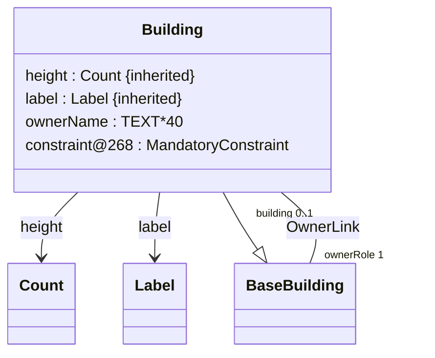

# INTERLIS-Modelle mit dem Compiler prüfen

Der Compiler prüft INTERLIS-Modelle der Versionen 2.3 und 2.4. Er liest
die `.ili`-Dateien, folgt den `IMPORTS` und prüft unter anderem, ob
verwendete Typen und Klassen existieren. So findest du Fehler im Modell,
bevor du es weitergibst oder als Grundlage für andere Werkzeuge verwendest.

## Starten

Führe die Beispiele in einer Shell im Wurzelverzeichnis dieses Git-Repositories
aus. Baue den Compiler mit einem Java-25-JDK und speichere den Pfad zum
Launcher für die weiteren Beispiele.

```sh
java build/interlis/ExistingJvmDistribution.java sdk
compiler=./target/jenesis-jvm/delivery/compiler/bin/interlis-compiler
"$compiler" --help
```

Der Launcher liegt nach dem Build direkt im Ausgabeverzeichnis.
Unter Windows heisst er `interlis-compiler.bat`. Die folgenden Shell-Beispiele
sind für macOS und Linux geschrieben.

## 1. Eine Datei prüfen

`Base` definiert unter anderem die Klasse `BaseBuilding` und braucht
keine weiteren Modelldateien.

```sh
"$compiler" check testdata/models/base24.ili
```

Bei Erfolg zeigt das Terminal keine Meldung. Die Standardausgabe (stdout)
und die Fehlerausgabe (stderr) bleiben leer. Der Exitcode ist `0`.

## 2. Ein Modell mit Importen prüfen

`Survey` importiert `Base` und erweitert dessen Klasse `BaseBuilding`.
Gib beide Dateien an, damit der Compiler die importierte Klasse findet.
Für lokale Dateien verwendet der Compiler die Pfade aus dem Aufruf.
Mit `--root Survey` sagst du, dass die Prüfung bei `Survey` beginnen soll.
`Base` steht als Eingabe bereit und wird über den Import einbezogen.
`--root` erwartet den Namen aus der `MODEL`-Deklaration. Wenn du
`--root` weglässt, dienen alle angegebenen Dateien als Ausgangspunkte.
Für mehrere gewünschte Modelle kannst du `--root` wiederholen.

```sh
"$compiler" check --root Survey \
  testdata/models/survey24.ili testdata/models/base24.ili
```

Auch hier bleiben stdout und stderr leer. Der Exitcode ist `0`.

## 3. Eine Fehlermeldung lesen

`--diagnostic-language de` wählt deutsche Meldungen. `--diagnostic-context` zeigt
zusätzlich die betroffene Stelle im Quelltext. Mit `--color never` bleibt
die Ausgabe beim Kopieren und in Protokollen frei von Farbsteuerzeichen.

```sh
"$compiler" check --diagnostic-language de --diagnostic-context --color never \
  testdata/models/broken24.ili
```

Ein Ausschnitt aus stderr mit gekürztem Dateipfad. stdout ist leer, der Exitcode ist `1`.

```text
ERROR <file:///…/testdata/models/broken24.ili>:10:5: Unerwartetes Token 'END'; erwartet wird <unknown>. [ILI-SYN-0002]
   9 |       missingType :
  10 |     END BrokenClass;
     |     ^~~
  11 |   END Data;
```

Die Meldung beginnt mit dem Schweregrad, gefolgt von Datei, Zeile und Spalte.
Der Diagnosecode steht nach dem Meldungstext. Die Markierung im Quellausschnitt zeigt, wo der Parser
den Fehler bemerkt. Schau auch auf die Zeile davor, wenn etwa ein Typ nach
einem Doppelpunkt fehlt.

Exitcode `0` steht für Erfolg, `1` für eine fachliche Ablehnung und `2`
für einen Bedienfehler. Beim Aufruf ohne Befehl sieht das so aus.

```sh
"$compiler"
```

stderr bei Exitcode `2`. stdout ist leer.

```text
missing command
Usage: interlis-compiler <command> [options] [files...]
Example: interlis-compiler check <File.ili>
Run interlis-compiler --help for commands and options.
```

## 4. Ein Ergebnis weiterverwenden

Mit `--json` schreibt `check` ein maschinenlesbares Ergebnis auf stdout.
Das eignet sich etwa für ein Skript, das Diagnosen auswertet.

```sh
"$compiler" check --json --root Survey \
  testdata/models/survey24.ili testdata/models/base24.ili
```

stdout bei Exitcode `0`. stderr ist leer.

```json
{"status":"ok","diagnostics":[]}
```

Für einen Überblick über Klassen und ihre Beziehungen verwende `diagram`.
Mit `--format mermaid` erhältst du Diagrammtext, den eine Markdown-Ansicht
mit Mermaid-Unterstützung wie unten darstellt. Die binäre Assoziation
`OwnerLink` erscheint als Linie mit Rollennamen und Kardinalitäten an den
beiden Enden.

```sh
"$compiler" diagram --format mermaid --root Survey \
  testdata/models/survey24.ili testdata/models/base24.ili
```

stdout bei Exitcode `0`. stderr ist leer.



## 5. Modelle aus einem Repository laden

Wenn viele Projekte dieselben Modelle importieren, kannst du die Dateien in
einem gemeinsamen Repository ablegen. Ohne explizite Repositoryliste
sucht die CLI fehlende Modelle zuerst neben den angegebenen Modelldateien
und danach im zentralen INTERLIS-Repository. Der Index `ilimodels.xml` eines
Repositorys ordnet Modellnamen ihren Dateien zu. Mit `--repository` lässt sich
ein Repository explizit auswählen. Zusammen mit `--root Survey` kann der
Compiler `Survey` und dessen Import `Base` selbst im Index finden.

Das Beispiel kopiert die beiden Dateien in ein temporäres Verzeichnis.
`--cache` hält die dabei gelesenen Inhalte für die nächsten Läufe bereit.

```sh
demo=$(mktemp -d)
demo=$(cd "$demo" && pwd -P)
repo="$demo/repo"
mkdir "$repo"
cp testdata/models/base24.ili testdata/models/survey24.ili "$repo/"
cat > "$repo/ilimodels.xml" <<'XML'
<TRANSFER>
  <ModelMetadata>
    <Name>Base</Name>
    <SchemaLanguage>ili2_4</SchemaLanguage>
    <File>base24.ili</File>
    <Version>1.0</Version>
  </ModelMetadata>
  <ModelMetadata>
    <Name>Survey</Name>
    <SchemaLanguage>ili2_4</SchemaLanguage>
    <File>survey24.ili</File>
    <Version>1.0</Version>
  </ModelMetadata>
</TRANSFER>
XML
"$compiler" check --repository "$repo" --root Survey --cache "$demo/cache"
```

Die Prüfung endet mit Exitcode `0`. stdout und stderr bleiben leer.

### Eine Auswahl für spätere Läufe speichern

Mit `--write-lock` hältst du die aufgelösten Repository-Quellen und ihre
Prüfsummen in einer XML-Datei fest. Mit `--read-lock` verwendest du dieselbe
Auswahl beim nächsten Lauf. `--offline` lässt den Compiler dafür nur
verifizierte Inhalte aus dem Cache verwenden. Fehlende Inhalte führen
zu einem Fehler. Ungepinnte lokale Projektdateien kannst du zwischen den
Läufen weiter bearbeiten.

```sh
"$compiler" check --repository "$repo" --root Survey --cache "$demo/cache" \
  --write-lock "$demo/survey.lock.xml"
"$compiler" check --repository "$repo" --root Survey --cache "$demo/cache" \
  --read-lock "$demo/survey.lock.xml" --offline
```

Beide Aufrufe enden mit Exitcode `0` und ohne Ausgabe auf stdout oder
stderr. Hier ist ein Ausschnitt aus dem Lock mit gekürztem Pfad.

```xml
<interlis-resolution-lock version="2" profile="ili2c-5.6.9">
  <model name="Base" version="1.0" source="file:///…/repo/base24.ili"
    sha256="4daeaa3677765ffa195fe03bf0de1ea2934ecd7c7db2b060f035ba8338ca3c6a"/>
  <!-- Weitere Einträge ausgelassen -->
</interlis-resolution-lock>
```

### Einzelne Quellen mit Pins festlegen

Ein Modellpin ist sinnvoll, wenn du bereits weisst, welche Ausgabe eines
Modells verwendet werden soll. `--model-pin NAME VERSION SOURCE SHA256`
erwartet in dieser Reihenfolge den Modellnamen, den exakten Versionswert,
die kanonische URI der Datei und den SHA-256-Hash ihrer Originalbytes als
64 Hexzeichen. Damit kannst du beispielsweise eine bestimmte Ausgabe von
`Base` als Abhängigkeit festlegen.

Mit `--source-pin SOURCE SHA256` prüfst du gezielt die Bytes an einer
Quell-URI. Das eignet sich auch für den Repository-Index, der selbst
keinen Modellnamen und keine Modellversion hat. Ein Lock ist praktisch,
wenn du die Auswahl für das gesamte Repository-Beispiel wiederholen willst.

Der folgende Aufruf verwendet Python 3, um die kanonischen Datei-URIs und
die Prüfsummen der Beispielquellen zu ermitteln. In einem echten Projekt
übernimmst du die erwarteten Prüfsummen aus der Ausgabe, der du vertraust.

```sh
file_uri() {
  python3 -c 'from pathlib import Path; import sys; print(Path(sys.argv[1]).resolve().as_uri())' "$1"
}
sha256() {
  python3 -c 'from pathlib import Path; import hashlib, sys; print(hashlib.sha256(Path(sys.argv[1]).read_bytes()).hexdigest())' "$1"
}
"$compiler" check --repository "$repo" --root Survey --cache "$demo/cache" \
  --model-pin Base 1.0 "$(file_uri "$repo/base24.ili")" "$(sha256 "$repo/base24.ili")" \
  --source-pin "$(file_uri "$repo/ilimodels.xml")" "$(sha256 "$repo/ilimodels.xml")"
```

Der Aufruf endet mit Exitcode `0`. stdout und stderr bleiben leer.

## Weitere Befehle

| Befehl | Wann er hilft |
|---|---|
| `compile` | Wenn ein gültiges Schema Voraussetzung für die weitere Verarbeitung ist. Wie `check` prüft der Befehl das Modell und seine Importe. |
| `analyze` | Wenn du den Analysestand brauchst. Bei Modellfehlern kann der Compiler dabei auch Teilergebnisse liefern. |
| `format` | Wenn du den Quelltext einheitlich einrücken und umbrechen willst. `format --check` meldet Formatierungsbedarf, `format --write` schreibt das Ergebnis zurück. |
| `version` | Wenn du die Version deiner Installation prüfen oder in einem Fehlerbericht angeben willst. |
| `capabilities` | Wenn ein Skript oder eine Integration die unterstützten Funktionen als JSON abfragen soll. |

Weitere Einstellungen für [Diagnosen](cli.md#diagnosen-und-farbe),
[Repositories und Locks](cli.md#repositories-und-locks) und das
[Netzwerk](cli.md#netzwerkeinstellungen) stehen in der [CLI-Referenz](cli.md).
